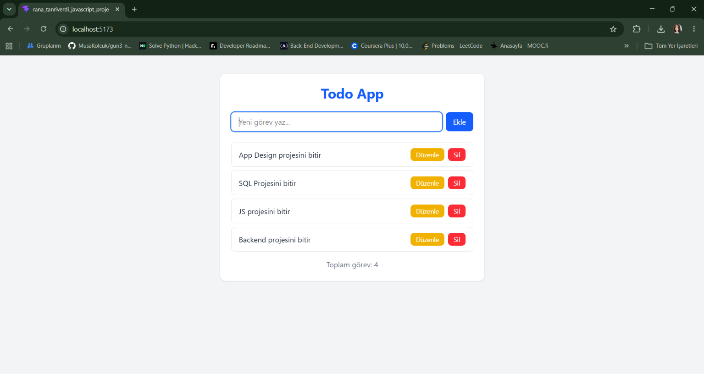

# Todo App

React ile geliştirilmiş, görev ekleme, listeleme, güncelleme ve silme işlemlerini yapabilen bir görev yönetimi uygulaması. Görevler tarayıcının LocalStorage alanında saklanır, böylece sayfa yenilense bile kaybolmaz.

Bu proje, Web Geliştirme eğitimi kapsamında JavaScript proje yönergesine uygun olarak hazırlanmıştır.

## Ekran Görüntüsü



## Özellikler

- **Ekle:** Yeni görev ekleme
- **Listele:** Eklenen görevleri listeleme
- **Güncelle:** Görev metnini düzenleme
- **Sil:** Görevi listeden kaldırma
- Görevlerin LocalStorage ile kalıcı olarak saklanması

## Kullanılan Teknolojiler

- React
- Vite
- Tailwind CSS
- LocalStorage

## Proje Yapısı

```
src/
├── components/
│   ├── TodoForm.jsx
│   ├── TodoItem.jsx
│   └── TodoList.jsx
├── interfaces/
│   └── todo.js
├── pages/
│   └── Home.jsx
├── App.jsx
├── index.css
└── main.jsx
```

## Kurulum

```bash
npm install
npm run dev
```

## Hazırlayan

Rana Tanrıverdi